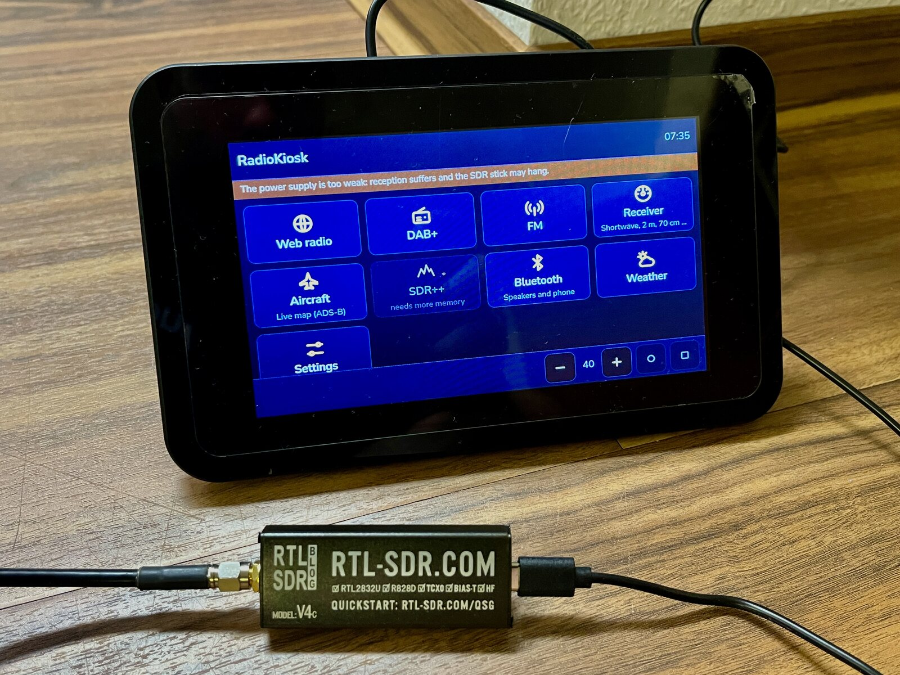
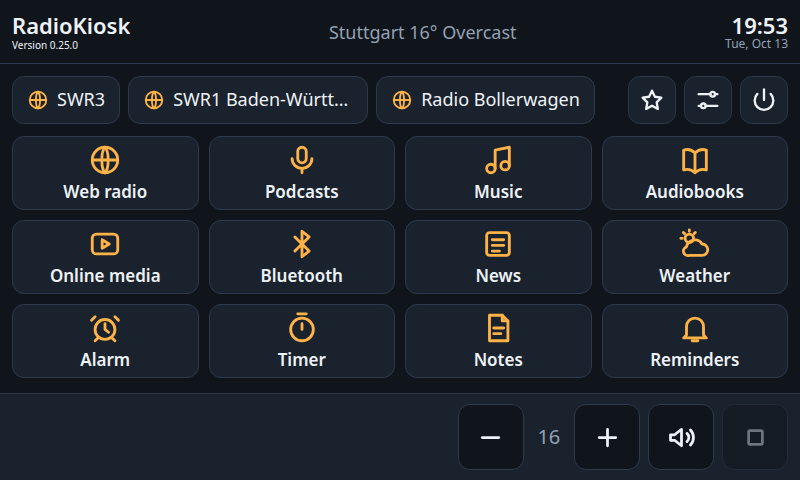
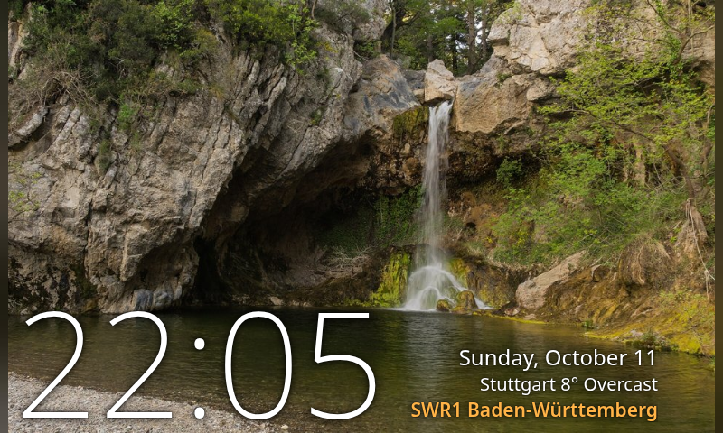
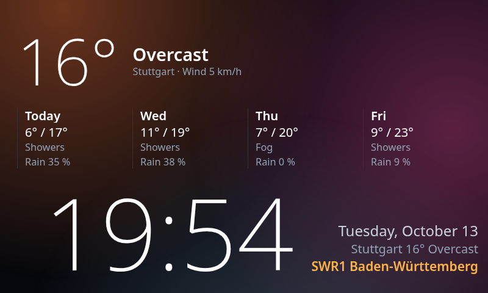
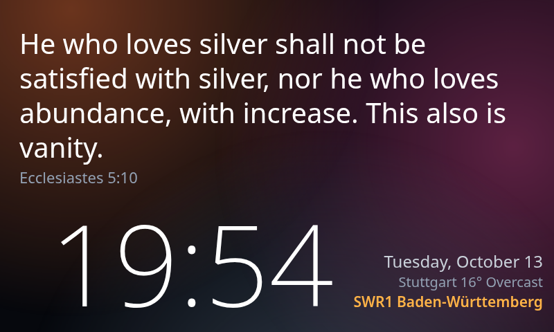
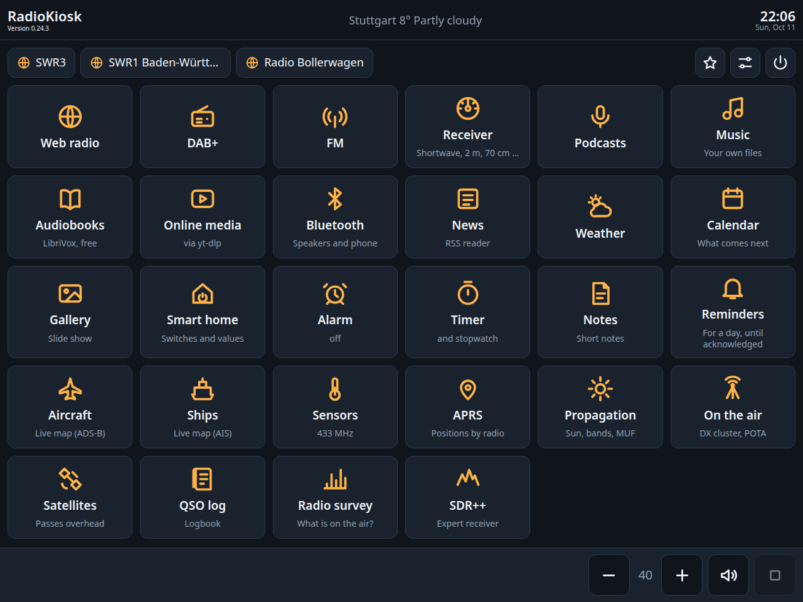
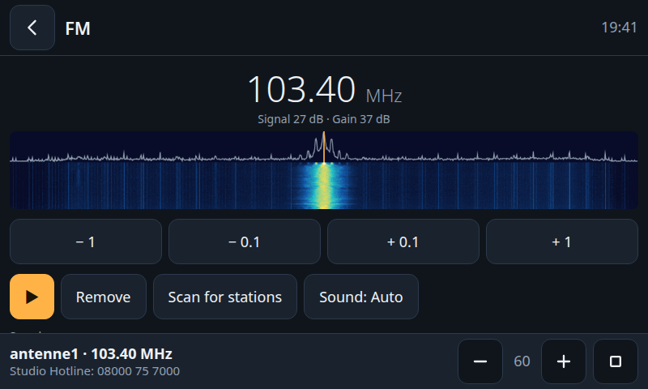
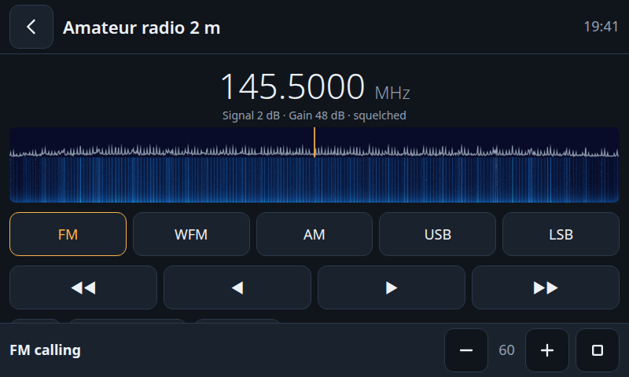
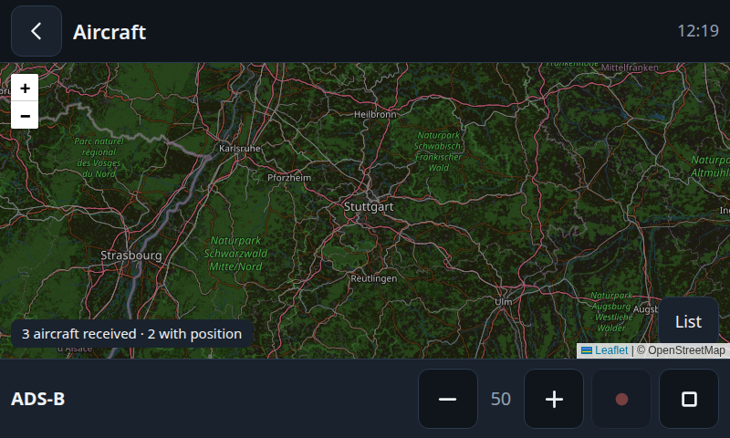

**English** · [Deutsch](README.de.md)

# RadioKiosk

A radio for the kitchen shelf, a digital picture frame, and with an RTL-SDR stick a world receiver for the shack: RadioKiosk turns a Linux computer into all three. It is built for a touch display, but runs just as well on a laptop or desktop with mouse and keyboard.

[](https://github.com/TechnikWeber/RadioKiosk/actions/workflows/tests.yml)



| | |
|---|---|
|  |  |
|  |  |
|  |  |
|  |  |

> Version 0.25: everything listed here is built, but not all of it has been tried on every kind of hardware. The release notes say what is untested.

## Install

```sh
curl -fsSL https://raw.githubusercontent.com/TechnikWeber/RadioKiosk/main/install.sh | bash
```

Works on Fedora, Debian, Ubuntu and Raspberry Pi OS. Run it as your normal user; it asks for your password to install packages, fetches RadioKiosk to `~/.local/share/radiokiosk` and starts it as a background service. Then open **RadioKiosk** from the application menu or go to <http://localhost:8080>.

Options, appended after `bash -s --`:

| Option | What it does |
|---|---|
| `--kiosk` | opens the interface full screen after every login, and lets the system install its security updates by itself (`--no-security-updates` leaves that out) |
| `--ham` | adds the radio hobby: aircraft, ships, radio sensors, APRS, satellites and SDR++ are installed and their tiles shown |
| `--with-sdrangel` | SDRangel as a second expert receiver |
| `--rotate=180` | turns the screen and the touch input (also `90`, `270`; Raspberry Pi OS) |

Without `--ham` you get what listening and everyday use need. The hobby tiles can be switched on later under **Settings › Tiles on the start screen**; a tile whose program is not installed is left out.

### Raspberry Pi

Flash **Raspberry Pi OS (64-bit) with desktop**, connect it to your network and run the installer with `--kiosk`. After the next start the Pi opens RadioKiosk by itself.

- **Screen upside down:** the official 7 inch display often is; add `--rotate=180`.
- **Power:** a Pi with display and stick needs a strong supply. RadioKiosk warns when the Pi reports too little voltage.
- **Pi 3:** works, with limits. The interface is there about two minutes after power-on, the waterfall is too much for its processor, and SDR++ does not fit into its memory.

## Hardware

| Part | Supported | Tested |
|---|---|---|
| Computer | 64-bit Linux on x86 or ARM: Fedora, Debian, Ubuntu, Raspberry Pi OS | Fedora 44 on a laptop; Raspberry Pi 3 B+ |
| Display | any, with or without touch; laid out for 800×480 upwards, one size up on large screens | official 7 inch display; 480×320 to 1920×1080 in a browser |
| SDR stick | optional. Any RTL2832U stick `librtlsdr` knows (RTL-SDR Blog V3/V4, Nooelec). Airspy, HackRF and SDRplay are not supported | RTL-SDR Blog V4 |
| Audio | every output PipeWire or PulseAudio offers: jack, USB, Bluetooth, HDMI | built-in audio |

Without a stick everything that comes over the internet works. Shortwave needs a stick that tunes below 24 MHz (the V4, or the V3 with direct sampling) and a long wire antenna.

## What it does

A small Python service controls players and receivers and serves a web interface that a browser shows full screen.

**Listening**

| Tile | What you get |
|---|---|
| Web radio | station search, popular stations, logos |
| DAB+ | scan, station list, scrolling text and the pictures stations send |
| FM | stereo, station names and radio text (RDS), band scan, waterfall |
| Receiver | free tuning in FM, AM and sideband with a band plan: long, medium and shortwave, amateur radio, PMR446, Freenet, CB; on the broadcast bands it lists who is on the air now |
| Podcasts | search, subscriptions, episodes; remembers how far you have heard |
| Music | your own files from a folder, USB stick or network folder |
| Audiobooks | public domain audiobooks from LibriVox |
| Online media | titles found and opened by yt-dlp, by search words or an address, played as sound; searches and titles can be kept |
| Bluetooth | connect a speaker, or let a phone play through this device |

**Everyday**

| Tile | What you get |
|---|---|
| News | RSS and Atom feeds as a list of the newest articles |
| Weather | current weather, a four-day forecast, official warnings |
| Calendar | the coming dates of calendars kept elsewhere, read from their iCal address (Google, Apple, waste collection, school holidays) |
| Gallery | slide show of a folder; pictures and short video clips can be added and deleted in the interface, also from a phone |
| Smart home | switches that call an address when tapped (a webhook of Home Assistant, a Shelly plug) and values that show what an address answers |
| Alarm, Timer | wake with a station or a sound; kitchen timer and stopwatch |
| Notes, Reminders | short notes; reminders for a day that stay up until acknowledged |

**Radio hobby** (with `--ham`)

| Tile | What you get |
|---|---|
| Aircraft, Ships | live maps from ADS-B and AIS |
| Sensors | wireless thermometers and weather stations nearby on 433 MHz |
| APRS | positions radio amateurs send on 144.800 MHz, on a map |
| Propagation | solar figures, band conditions and the MUF of the nearest ionosonde |
| On the air | DX cluster and Parks on the Air; a tap tunes the receiver there |
| Satellites | passes of the ISS and other satellites worth hearing |
| QSO log | logbook with ADIF and CSV export |
| Radio survey | watches a range for a chosen time and reports what was on the air |
| SDR++ | the full SDR program for everything else |

Settings and switching off are two small buttons at the end of the favourites row. Every station can get a star, whatever its source; favourites start with one tap from the start screen. The interface is English by default and can be switched to German.

### Picture frame and idle screen

After a while without a touch the idle screen takes over. It shows the clock on black with the display dimmed, or one or several of these in turn: the gallery behind the clock, the weather with the days ahead, the newest news, the DX cluster, a Bible verse for the day. How long each one stays is set one by one, such as three minutes of pictures, then a minute of weather and a minute of news. Clock, date, weather and what is playing stay in view.

As a picture frame the gallery shows any folder the computer can read. A picture that does not fill the screen gets a blurred copy of itself behind it instead of black bars, or it is cropped and pans slowly across; the change between pictures fades, wipes, turns the page or zooms. A video added through the interface (nearly any format, also straight from a phone) becomes a short silent clip of at most 30 seconds, small enough for a Raspberry Pi; among the pictures it runs in a loop until the slide show moves on. Until you choose a folder, sample pictures are shown (public domain, see [demo-pictures/CREDITS.md](demo-pictures/CREDITS.md)).

At night the idle screen can be dimmed, reduced to the dimmed clock, or the display switched off (**Settings › Idle screen**). So that a forgotten radio does not play for days, playback stops by itself after eight hours without a touch (**Settings › Playback**).

### Warnings

For the set location in Germany, RadioKiosk shows the warnings of the weather service (through brightsky.dev) and of civil protection (NINA, from warnung.bund.de) as a line below the header. A warning stays until somebody marks it as read. On the idle screen it is a line; one of the two highest levels comes up once over the whole idle screen. A sound for the highest level can be switched on.

### Bible verse and Herrnhuter Losungen

The verse comes from the curated list of the [Bible Verse Widget](https://github.com/TechnikWeber/bible-verse-widget) (public domain translations) and is the same on the same day in both.

The Losungen are not part of RadioKiosk: they are free of charge for non-commercial use, but not free content. Download the year file (XML, a ZIP) yourself from <https://www.losungen.de/digital/> and import it under **Settings › Content › Bible verse**, from a phone by remote control or from a folder or USB stick. This has to be repeated every year.

### Remote control and other programs

With remote control switched on under Settings, phones and computers in the same network can open the interface in a browser; other devices can also listen along at `http://<address>:8080/live.mp3`. A home automation or a script can control RadioKiosk the same way, see [docs/api.md](docs/api.md). There is no login, so use it only in a network you trust.

### Good to know

- Only one receiver can use the stick at a time; the service stops the running one before starting the next. A stick that has hung on the USB bus is restarted.
- FM and the free receiver use RadioKiosk's own receiver, written in Python with NumPy. The waterfall is off by default; under Settings each of the two can be switched to the lighter `rtl_fm` instead.
- Podcasts, music and online media pause with the button that stops radio; held for a second it stops them for good. A record button can be switched on under Settings; it saves to `Music/RadioKiosk`.
- yt-dlp is not part of RadioKiosk. The installer or the tile fetches it from its project; a fetched copy is renewed once a week.
- Listening to radio services not meant for the public is restricted in many countries. The band plan only contains broadcast, amateur radio and licence-free bands.

## Updating

Under **Settings › Device**, "Look for updates" asks GitHub for a newer release; RadioKiosk also looks once a day and, unless switched off, installs a new release at night while nothing is playing.

The new version is fetched into a folder of its own and tried first. Only then the switch is made, and if the new version does not answer within two and a half minutes, a guard switches back. Only releases are installed. Packages of the operating system are not touched; a version that needs a new one says so, and the installer is run once more.

## Run from source

```sh
git clone https://github.com/TechnikWeber/RadioKiosk.git
cd RadioKiosk
python3 -m venv .venv
.venv/bin/pip install -r requirements.txt
.venv/bin/python -m radiokiosk
.venv/bin/python -m unittest     # the tests need no SDR stick
```

This needs the programs the installer sets up. With a stick, the kernel's TV driver must not claim it:

```sh
echo 'blacklist dvb_usb_rtl28xxu' | sudo tee /etc/modprobe.d/blacklist-rtlsdr.conf
```

## Settings file

Nearly everything is set in the interface. A few things live only in the optional file `~/.config/radiokiosk/config.json`:

| Key | Default | Meaning |
|---|---|---|
| `host` | `0.0.0.0` | set to `127.0.0.1` to never listen on the network |
| `port` | `8080` | port of the web interface |
| `country` | `DE` | country for the list of popular web radio stations |
| `gain` | `auto` | tuner gain: `auto` adjusts it while listening, a number in dB forces it |
| `apps` | SDR++, SDRangel | external programs shown as tiles |

## License

[MIT](LICENSE). Shortwave schedules come from [EiBi](http://www.eibispace.de/) by Eike Bierwirth, who offers them free of charge. The bundled map library Leaflet is BSD-2-Clause licensed, see `web/vendor/leaflet/LICENSE`.
